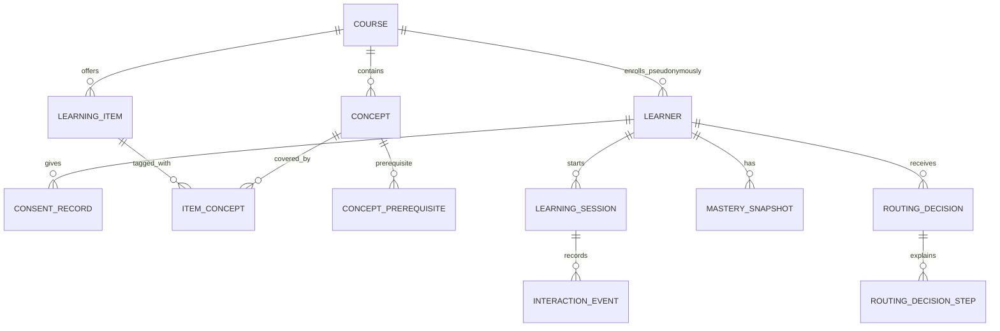

# Database Schema Draft

Status: initial design for team and supervisor review. This is a proposed pilot schema, not yet an approved ethics protocol or final implementation contract.

## Design goals

- Support a single-course pilot with a prerequisite concept graph.
- Record opt-in participation, learning interactions, mastery estimates, and explainable routing decisions.
- Keep identity data out of the learning database and make event export predictable.
- Keep model outputs traceable by recording the model and schema versions used.

## Proposed entities

| Entity | Important fields | Purpose |
|---|---|---|
| `Course` | `id`, `code`, `title`, `term`, `created_at` | Pilot course and academic offering. |
| `Learner` | `id` (random UUID), `created_at`, `status` | Pseudonymous participant record. No name, email, student number, or LMS identifier. |
| `ConsentRecord` | `id`, `learner_id`, `course_id`, `form_version`, `status`, `consented_at`, `withdrawn_at` | Evidence of opt-in status and the consent version. |
| `Concept` | `id`, `course_id`, `slug`, `name_en`, `name_ar`, `description_en`, `description_ar` | Course concept node. |
| `ConceptPrerequisite` | `id`, `prerequisite_concept_id`, `dependent_concept_id` | Directed edge: the dependent concept requires the prerequisite concept. |
| `LearningItem` | `id`, `course_id`, `item_type`, `content`, `authorship`, `status` | Diagnostic or practice question. Keep instructor-authored and generated items distinguishable. |
| `ItemConcept` | `learning_item_id`, `concept_id`, `tag_role` | Links an item to one or more concepts. |
| `LearningResource` | `id`, `course_id`, `title`, `source_type`, `source_locator` | Instructor-provided source material and citation location. |
| `ResourceChunk` | `id`, `resource_id`, `chunk_key`, `text`, `source_locator` | Text segment used for retrieval. Store embeddings in the selected vector store; retain a stable chunk key here. |
| `ResourceChunkConcept` | `resource_chunk_id`, `concept_id` | Concept labels used by concept-aware retrieval. |
| `LearningSession` | `id`, `learner_id`, `course_id`, `started_at`, `ended_at` | One learner's platform session. |
| `InteractionEvent` | `event_id`, `learner_id`, `course_id`, `session_id`, `event_type`, `occurred_at`, `received_at`, `schema_version`, `client_sequence`, `learning_item_id`, `concept_id`, `is_correct`, `response_time_ms`, `payload` | Append-oriented event record for learning behavior. |
| `MasterySnapshot` | `id`, `learner_id`, `course_id`, `concept_id`, `mastery`, `model_name`, `model_version`, `computed_at`, `based_on_event_id` | Historical estimate of mastery for a concept. |
| `RoutingDecision` | `id`, `learner_id`, `course_id`, `session_id`, `trigger_event_id`, `diagnosed_concept_id`, `root_cause_concept_id`, `mastery_before`, `threshold`, `reason_code`, `rationale`, `model_version`, `created_at` | The decision to change a learner's path, including a readable explanation. |
| `RoutingDecisionStep` | `decision_id`, `position`, `concept_id`, `step_type` | Ordered concept path supporting the causal explanation. |
| `RoutingRecommendation` | `decision_id`, `learning_item_id`, `position` | Remedial items proposed by a routing decision. |

## Relationship sketch



## Important constraints and indexes

- `Course(code, term)` is unique.
- `Concept(course_id, slug)` is unique.
- `ConceptPrerequisite(prerequisite_concept_id, dependent_concept_id)` is unique; a concept cannot require itself. Validate that both nodes belong to the same course and that the graph stays acyclic in the graph service.
- `ConsentRecord(learner_id, course_id, form_version)` is unique. Event ingestion must reject records unless the learner has active consent for that course.
- `LearningItem(course_id, item_type, external_key)` is unique when an external key is supplied.
- `InteractionEvent.event_id` is a UUID idempotency key. Also enforce unique `(session_id, client_sequence)` when the client supplies a sequence.
- `MasterySnapshot.mastery` is constrained to the inclusive range 0.0–1.0.
- Index events by `(course_id, learner_id, received_at)` and `(session_id, client_sequence)`; index mastery snapshots by `(learner_id, concept_id, computed_at)` and routing decisions by `(learner_id, created_at)`.
- Keep interaction events append-only through application permissions/services. Corrections should be new events, not silent edits.

## Interaction log contract

Store one event per row in PostgreSQL and export one event per line as JSONL. The core fields are typed columns; `payload` is a small, versioned JSON object for event-specific details. Do not put a full answer, name, email, student number, IP address, or official grade in the payload.

Example `answer_submitted` event:

```json
{
  "event_id": "a8c5fc14-121d-4a84-a26b-4306d770f39d",
  "schema_version": "1.0",
  "event_type": "answer_submitted",
  "learner_id": "4a84b0da-42de-4b9b-a5ed-eb431d48c922",
  "course_id": "course-x-2026",
  "session_id": "f3ee98b5-9329-4c53-a83c-9b2b2b41c35c",
  "client_sequence": 12,
  "occurred_at": "2026-10-26T10:15:30Z",
  "received_at": "2026-10-26T10:15:31Z",
  "learning_item_id": "item-017",
  "concept_id": "concept-functions",
  "is_correct": false,
  "response_time_ms": 42000,
  "payload": {
    "hint_count": 1,
    "answer_format": "multiple_choice"
  }
}
```

`occurred_at` is client-reported time; `received_at` is server-generated UTC time and is authoritative for ingestion order. Validate event type and payload against the stated schema version. The event UUID allows safe retries without duplicate records.

## Privacy and consent boundary

- The project database stores random pseudonymous learner IDs only. Pseudonymization is not the same as anonymization if a separate identity mapping exists.
- If re-contact is necessary, keep the identity-to-pseudonym mapping separately under the supervisor's control; do not place it in this repository or the application database.
- Store no official grades. A question's correctness may be stored because it is needed for knowledge tracing; it must not be treated as a course grade.
- The consent form, access list, retention period, withdrawal handling, and public dataset release process need supervisor/institutional approval before pilot collection. Do not collect data before approval.
- For release, remove identifiers and assess rare combinations that could re-identify learners. Publish only fields allowed by the approved protocol.

## Decisions to confirm before implementing Django models

1. Does the pilot need any re-contact capability? Prefer no; if yes, keep the identity mapping outside this database.
2. What are the approved retention and withdrawal rules for already-collected events?
3. Should learner/courses use an enrollment table, or is one pilot course enough for the MVP?
4. Which event types are in scope for the first pilot (`answer_submitted`, `hint_requested`, `resource_opened`, `explanation_viewed`, etc.)?
5. Which vector store will be used, and what stable identifier will connect its chunks to `ResourceChunk`?
6. Will instructor review be required before generated practice items become available to learners?
